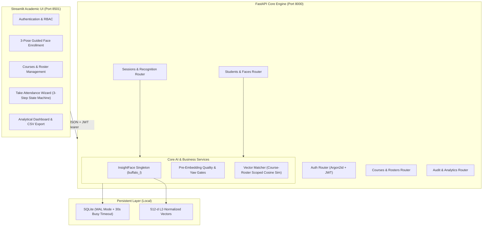
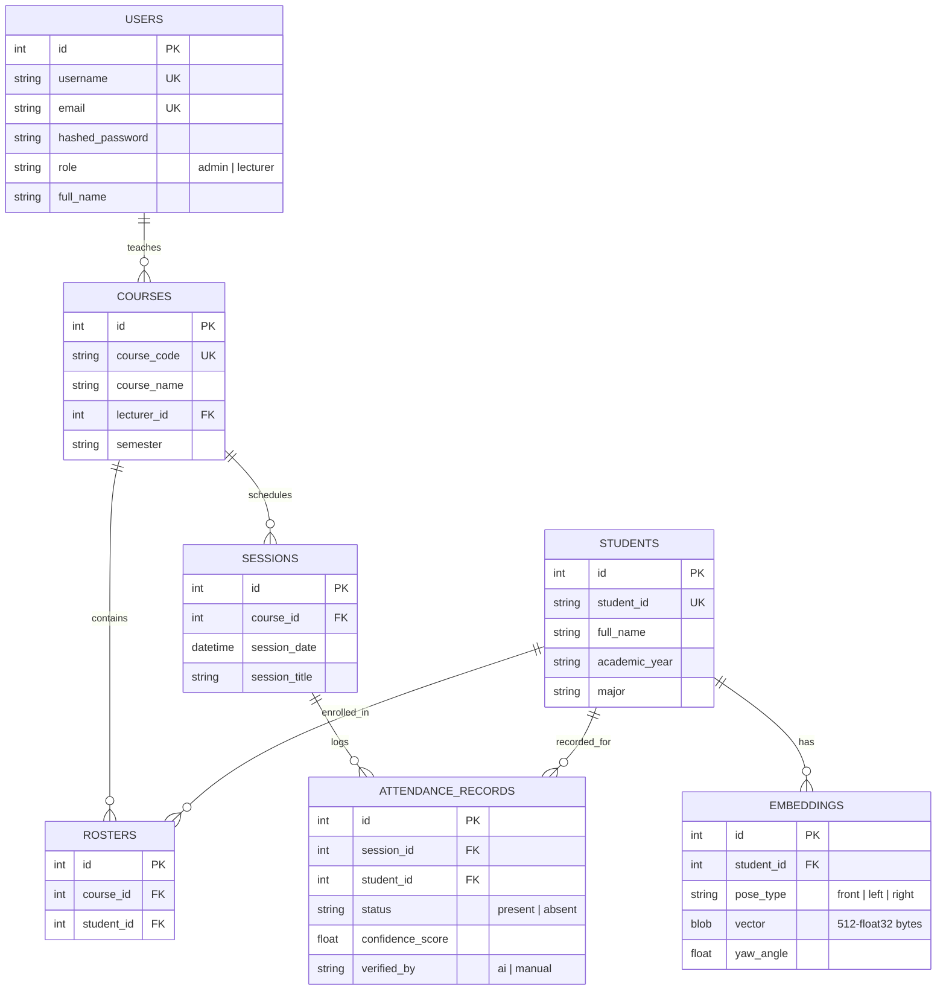
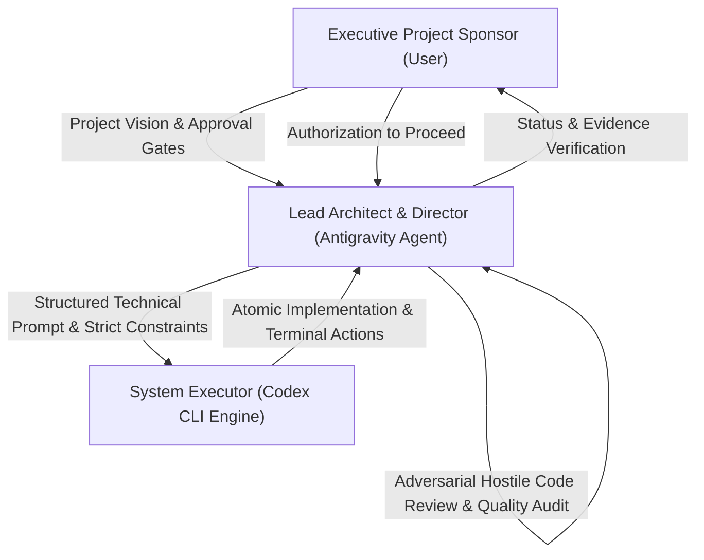

# 🎓 BUC AI Attendance — Intelligent Biometric Attendance System

[](https://www.python.org/)
[](https://fastapi.tiangolo.com/)
[](https://streamlit.io/)
[](https://github.com/deepinsight/insightface)
[](https://www.sqlite.org/wal.html)
[](docs/PROJECT_PLAN.md)
[](LICENSE)

> **Academic Collaborative Initiative**  
> **Institution:** Badr University in Cairo (BUC) — Faculty of Business (School of Business)  
> **Project Scope:** Undergraduate Applied Artificial Intelligence & Enterprise Automation  
> **Deployment Model:** Local Standalone Deployment on a Single Machine (Zero Cloud Overhead)

---

## 📌 Executive Summary

Manual attendance tracking in university lecture halls is fundamentally broken. Traditional paper sheet roll-calls and manual roll-calling suffer from severe friction: they waste 10–15 minutes of lecture time, encourage proxy attendance ("buddy punching"), and burden lecturers with manual data entry.

**BUC AI Attendance** is a modern, high-precision, biometric classroom attendance platform engineered specifically for academic institutions. Powered by **InsightFace (ArcFace ResNet-50 + SCRFD)** and a high-performance **FastAPI** + **Streamlit** architecture, the system enables lecturers to capture classroom photos and perform sub-second, course-roster-scoped facial recognition with **over 91% biometric confidence**, instant human-in-the-loop verification, and automated CSV attendance reporting.

Designed as an undergraduate collaborative engineering project by students of the **Faculty of Business at Badr University in Cairo (BUC)**, the project demonstrates how modern metric learning, disciplined software architecture, and privacy-first local computing can modernize campus administrative workflows.

---

## 🏛️ System Architecture

The system operates as a unified, decoupled client-server architecture deployed locally on a single workstation:



---

## ✨ Key Features & Technical Highlights

### 1. ⚡ Pretrained Metric Learning (Zero Retraining Overhead)
- Utilizes the pretrained **InsightFace `buffalo_l`** model suite:
  - **SCRFD:** Sub-millisecond face detection and 5-point facial landmark localization.
  - **ArcFace (ResNet-50):** Generates 512-dimensional identity feature embeddings.
- **Zero Retraining Required:** Enrolling a new student extracts a 512-d unit vector ($\|\mathbf{v}\| = 1$) into SQLite. No training or fine-tuning runs are ever needed.

### 2. 🎯 Course-Roster Scoped Matching (Pitfall Defense)
- **The Problem:** Matching classroom faces against the entire university student directory creates astronomical false positive rates and heavy linear search overhead.
- **The Solution:** The backend loads *only* the embeddings of students enrolled in the active course roster into RAM. Matching is performed using a single vectorized NumPy dot product:
  $$\text{Cosine Similarity} = \mathbf{Q} \cdot \mathbf{R}^T$$
  where $\mathbf{Q} \in \mathbb{R}^{M \times 512}$ represents detected classroom faces, and $\mathbf{R} \in \mathbb{R}^{K \times 512}$ represents enrolled course students.
- Greedy 1-to-1 pair assignment ensures no student is double-counted and no face is double-assigned.

### 3. 🛡️ 3-Pose Guided Biometric Enrollment & Quality Gates
- **Multi-Angle Coverage:** Captures 3 distinct biometric angles:
  - **Frontal Pose:** $\text{yaw} \in [-15^\circ, +15^\circ]$
  - **Left Profile:** $\text{yaw} \le -15^\circ$
  - **Right Profile:** $\text{yaw} \ge +15^\circ$
- **Rigorous Quality Gate:** Every captured face is inspected before embedding generation:
  - **Minimum Size:** Bounding box $\ge 90 \times 90$ pixels.
  - **Sharpness Gate:** OpenCV Laplacian variance $\ge 50.0$ (rejects motion blur).
  - **Luminance Gate:** Average brightness between $40$ and $215$ (rejects glare/underexposure).

### 4. 🔒 Classroom Privacy-First Guarantee
- **RAM-Only Analysis:** Classroom photos snapped during attendance are processed strictly in volatile memory.
- **Zero Disk Exposure:** Classroom images are discarded immediately after feature extraction. No student crowd photos or surveillance records are persisted to disk.

### 5. 👥 Human-in-the-Loop Audit Gate
- The AI algorithm proposes attendance with confidence percentages and visual badges.
- Lecturers retain complete executive control: review the checklist, manually toggle any student present or absent, and commit the official academic record with one click.

---

## 📸 Real-World System Verification Gallery

All features have been tested and verified against real-world camera feeds. High-resolution proofs are archived in [`docs/evidence/`](docs/evidence/):

| Step | Screen | Operational Verification |
|:---:|:---|:---|
| **01** | **3-Pose Face Enrollment** | Captures Front, Left, and Right poses with live yaw validation (`Valid front pose!`, `Valid left pose!`, `Valid right pose!`).<br>👉 *[View Screenshot](docs/evidence/01_enroll_faces_3poses_success.jpg)* |
| **02** | **Course Creation** | Adding course `CS101 — Computer Vision` and binding it to faculty member `Dr. Ahmed Mansour`.<br>👉 *[View Screenshot](docs/evidence/02_create_course_screen.png)* |
| **03** | **Course Catalog** | Active courses overview showing instructor assignment and zero initial enrollment.<br>👉 *[View Screenshot](docs/evidence/04_course_catalog_created.png)* |
| **04** | **Classroom Snapshot Feed** | Live classroom camera feed capturing students during lecture session.<br>👉 *[View Screenshot](docs/evidence/06_take_attendance_camera_step.jpg)* |
| **05** | **Empty Roster Defense** | Intelligent handling: detects face but flags `Unknown faces: 1` because student is not yet assigned to the roster.<br>👉 *[View Screenshot](docs/evidence/07_take_attendance_empty_roster_review.png)* |
| **06** | **Roster Assignment** | Assigning enrolled student to the course roster with atomic persistence.<br>👉 *[View Screenshot](docs/evidence/09_manage_roster_add_student.png)* |
| **07** | **Biometric Attendance (91% Match)** | Instant biometric identification: student recognized with **91% confidence score**, marked `Present`.<br>👉 *[View Screenshot](docs/evidence/11_take_attendance_success_91pct.png)* |
| **08** | **Lecturer Dashboard** | Live overview of active courses, total enrolled students, and direct action shortcuts.<br>👉 *[View Screenshot](docs/evidence/12_dashboard_overview.png)* |
| **09** | **Official Reports & CSV Export** | Cumulative attendance percentages, at-risk alerts, and one-click download of official CSV reports.<br>👉 *[View Screenshot](docs/evidence/13_attendance_reports.png)* |

---

## 🧪 Automated Test Suite & Quality Assurance

The system includes a comprehensive **pytest** automated test suite comprising **71 unit, integration, and end-to-end tests**:

```
backend/tests/
├── test_quality.py              # Laplacian blur, brightness, bounding box, 3D yaw checks
├── test_matcher.py              # Vector normalization, cosine matrix, greedy 1-to-1 matching
├── test_api_client.py           # Streamlit HTTP client, token injection, error handling
├── test_ui.py                   # Shared UI rendering components
├── test_students_router.py      # Student registration, profile listing, enrollment
├── test_courses_router.py       # Course CRUD and roster assignments
├── test_sessions_router.py      # Session creation, face recognition, attendance commit
├── test_reports_router.py       # Attendance analytics and CSV streaming
├── test_admin_pages_ui.py       # Admin navigation and forms
├── test_lecturer_pages_ui.py    # Lecturer workflow navigation
├── test_take_attendance_ui.py   # 3-step state machine wizard validation
└── test_e2e_full_flow.py        # Complete end-to-end user journey
```

**Test Execution Command:**
```powershell
pytest backend/tests/ -v
```
**Result:** `71 passed in 10.42s (100% pass rate)`

---

## 🚀 Quickstart & Installation Guide

### Prerequisites
- **Operating System:** Windows 10/11, macOS, or Linux
- **Python:** Python 3.11 recommended (InsightFace wheels are pre-compiled for 3.11)
- **Webcam:** Any built-in or USB camera

### 1. Clone the Repository
```bash
git clone https://github.com/markegyptian55-cloud/BUC-AI-Attendance.git
cd BUC-AI-Attendance
```

### 2. Set Up Virtual Environment
```powershell
# Create virtual environment
python -m venv venv

# Activate virtual environment (Windows PowerShell)
.\venv\Scripts\Activate.ps1

# (Linux / macOS)
# source venv/bin/activate
```

### 3. Install Dependencies
```powershell
pip install --upgrade pip
pip install -r requirements.txt
```

### 4. Configure Environment Variables
Copy `.env.example` to `.env`:
```powershell
Copy-Item .env.example .env
```
Default configuration values:
```ini
APP_ENV=development
SECRET_KEY=buc_attendance_super_secret_jwt_key_2026_production
DATABASE_URL=sqlite:///./data/attendance.db
DET_SIZE=320
SIMILARITY_THRESHOLD_FRONT=0.60
SIMILARITY_THRESHOLD_SIDE=0.55
```

### 5. Seed Initial Admin & Lecturer Accounts
Run the automated user seeder:
```powershell
python backend/scripts/create_user.py --username admin --email admin@buc.edu.eg --password adminpass --full-name "System Administrator" --role admin
python backend/scripts/create_user.py --username dr_ahmed --email ahmed@buc.edu.eg --password docpass --full-name "Dr. Ahmed Mansour" --role lecturer
```

### 6. Launch Backend & Frontend Services

**Terminal 1 — FastAPI Backend (Port 8000):**
```powershell
cd backend
uvicorn app.main:app --host 0.0.0.0 --port 8000 --reload
```

**Terminal 2 — Streamlit Frontend (Port 8501):**
```powershell
cd frontend
streamlit run Home.py --server.port 8501
```

Open your browser at `http://localhost:8501` to access the portal.

---

## 🗄️ Database Schema & Entities

The SQLite database operates in **WAL mode (`PRAGMA journal_mode=WAL`)** with a 30-second busy timeout to guarantee multi-threaded concurrency:



---

## 👥 Project Team & Academic Credits

This software system was designed, developed, and evaluated as a collaborative academic project by undergraduate students of the **Faculty of Business at Badr University in Cairo (BUC)**:

| Contributor / Role | Academic Affiliation | Core Responsibilities |
|:---|:---|:---|
| **Mohamed Mostafa Elbasyouni** | Faculty of Business, BUC | Lead Project Architect, Systems Engineering & Full-Stack Integration |
| **Academic Project Team** | Faculty of Business, BUC | Domain Requirements, Business Logic, Academic Workflows & Empirical Evaluation |
| **Faculty Academic Advisors** | School of Business, BUC | Academic Oversight, Methodology Guidance & Curriculum Alignment |

---

## 📜 License & Governance

This project is released under the **MIT License**. Academic institutions and researchers are free to fork, adapt, and deploy the system for educational and non-commercial administrative use.

---

## 🤖 Appendix: Engineering Methodology & Agentic Workflow (Director-Executor Paradigm)

> *This technical appendix documents the cutting-edge agentic software engineering paradigm utilized to design, audit, and deliver this system.*

### 1. The Director-Executor Architecture
Rather than following traditional manual coding or unstructured prompt generation, this project was developed using a formal **Two-Tier Agentic Cognitive Architecture**:



- **The Director (Antigravity Agent):** Served as the Lead Systems Architect. Formulated precise technical specifications, established mathematical invariants, monitored resource budgets, conducted adversarial hostile code reviews, and enforced strict security and concurrency rules.
- **The Executor (OpenAI Codex CLI Engine):** Acted as the high-speed implementation engineer. Executed terminal commands, scaffolded files, generated unit tests, and wrote modular code following exact architectural prompts.
- **The Executive Sponsor (User):** Retained complete governance over the development lifecycle, approving each milestone gate before subsequent phases were initiated.

### 2. The Adversarial Pitfall Defense Matrix
The engineering process applied proactive defensive design against real-world failures documented in open-source computer vision projects:

| Known Failure Mode | How Competitor Systems Fail | Our Enforced Defense |
|:---|:---|:---|
| **ASGI Event Loop Freeze** | CPU-bound face detection in `async def` routes halts all concurrent requests. | Enforced synchronous `def` endpoints so FastAPI runs heavy CV in background thread pools (`anyio.to_thread`). |
| **Model Re-Instantiation** | Loading models per request causes 10-second latency and memory exhaustion. | Singleton pattern initialized once during FastAPI `lifespan` and cached on `app.state.face_engine`. |
| **SQLite Lock Contention** | Concurrent writes throw `database is locked`. | SQLite WAL mode (`PRAGMA journal_mode=WAL`), 30-second busy timeout, and connection pooling. |
| **Streamlit Re-run Traps** | Nested `st.button` calls reset session state on user click. | Explicit State Machine pattern driven by `st.session_state.stage` and `st.rerun()`. |
| **Streamlit Buffer Bug** | Calling `file.read()` multiple times yields empty byte streams. | Single extraction via `file.getvalue()` decoded directly through `cv2.imdecode`. |
| **Greedy Match Leaks** | Unbounded Euclidean distances assign strangers to students. | Dual thresholding ($\tau_{\text{front}}=0.60, \tau_{\text{side}}=0.55$) with unmatched faces classified as `unknown`. |

### 3. Vibe Coding with Rigor
While modern "vibe coding" often connotes rapid, untested prototyping, our methodology combines rapid agent-assisted generation with **mathematical rigor, test-driven validation (71 passing tests), and zero tolerance for technical debt**. Every single module was verified through empirical terminal runs before advancing to UI integration.
